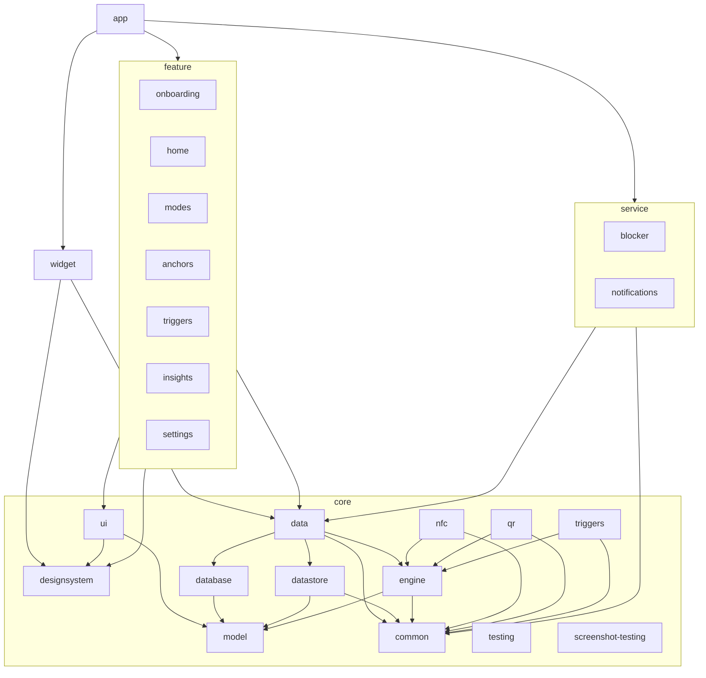

# Anchor

**Tap to focus. Tap again to come back.**

Anchor turns any cheap NFC sticker (or a printed QR code) into a physical "anchor" for your phone.
Tap the phone on it to start a focus mode that blocks the apps you choose; to end the session you
have to walk back and tap the anchor again. Flexible to start, strict to stop.

[](https://github.com/uveshm003/anchor-android/actions/workflows/ci.yml)
[](LICENSE)

> Inspired by the idea behind [Brick](https://getbrick.com). Anchor is an independent open-source
> project, not affiliated with or endorsed by Brick, and uses none of its branding or assets.

> **Status:** early development. See the [roadmap](#roadmap); nothing below is usable yet unless the
> roadmap marks it done.

## Features (planned)

- **Anchors**: pair NFC tags (NTAG213/215/216) or printable QR codes. Several per phone: desk,
  bedroom, car.
- **Modes**: Deep Work, Study, Sleep, Driving, Family Time or your own. Block a list of apps, or
  allow only a list. Phone, emergency calls, the launcher and Anchor itself are never blocked.
- **Start however you like**: press and hold in the app, tap an anchor, Quick Settings tile,
  widget, app shortcut, or automatically on a schedule, at a place, while driving, when a Bluetooth
  device connects, or when you walk into a BLE "Space" such as your bedroom.
- **Stop deliberately**: by tapping your anchor, when a timer ends, or when the trigger that started
  the mode ends (you leave the place, the car disconnects).
- **Quiet actions**: Do Not Disturb, ringer mode, hold notifications from blocked apps until the
  session ends ("While you were anchored"), optional driving auto-reply.
- **Safety first**: 3 emergency unlocks per rolling 7 days, and a 24-hour delayed unlock if an
  anchor is lost. Nobody gets locked out for good.
- **Strict mode** (opt-in): extra friction against uninstalling or changing settings mid-session.
- **Weekly Activity**: time anchored, sessions per mode, block attempts, streaks.
- English and Hindi.

## Privacy

Anchor works entirely on your device. It has **no `INTERNET` permission**, and CI fails the build
if any dependency tries to add one. No accounts, analytics, crash reporting, ads or backend.
Anchor stores only a salted hash of each tag's ID, and held notifications are stored as
package + count + time unless you opt in to keeping titles.

## Roadmap

| Milestone | Goal | Release | Status |
|---|---|---|---|
| M0 Foundation | Design system, app shell, test infrastructure, architecture docs | – | In progress |
| M1 Modes & blocking core | Modes, engine v1, blocker service, hold-to-start, emergency unlock, onboarding | `v0.1.0` | Planned |
| M2 Anchors | NFC + QR anchors, tap to start/stop, lost-anchor recovery | `v0.2.0` | Planned |
| M3 Automatic modes | Schedule, driving, Bluetooth, Spaces, places, conflict resolution | `v0.3.0` | Planned |
| M4 Quiet actions | DND, ringer, notification holding, driving auto-reply | `v0.4.0` | Planned |
| M5 Strict mode, insights & surfaces | Strict guards, Weekly Activity, widget, tile, shortcuts, Hindi | `v0.5.0` | Planned |
| M6 Hardening & release | Resilience, battery audit, baseline profile, Play readiness | `v1.0.0` | Planned |

Progress is tracked in [issues](https://github.com/uveshm003/anchor-android/issues) and
[milestones](https://github.com/uveshm003/anchor-android/milestones).

## Building

Requirements: JDK 21 or newer (CI uses 25), Android SDK with platform 37, and an Android 12+ device
or emulator. NFC needs a real phone.

```bash
./gradlew assembleDebug            # build the debug APK
./gradlew installDebug             # install on a connected device
./gradlew spotlessApply ciCheck    # everything CI runs: format, detekt, lint, tests, screenshots, coverage, privacy
./gradlew recordRoborazziDebug     # re-record screenshot goldens after an intended UI change
./gradlew connectedDebugAndroidTest  # instrumented tests on a device
```

## Architecture

Single-activity Jetpack Compose app, unidirectional data flow, and a pure-Kotlin **mode engine**
that turns trigger events and user intents into a new session state plus a list of commands that thin
Android adapters execute. Details: [`docs/architecture.md`](docs/architecture.md), decisions:
[`docs/adr/`](docs/adr/).



## Contributing

Every change goes through an issue and a reviewed pull request. See
[CONTRIBUTING.md](CONTRIBUTING.md). Security reports: [SECURITY.md](SECURITY.md).

## License

[Apache License 2.0](LICENSE)
