# Architecture

Anchor is a single-activity Jetpack Compose app split into Gradle modules by layer and feature.
This page is the overview; decisions and their reasons live in [`adr/`](adr/) (UDF: [0002](adr/0002-state-management-and-udf.md), engine: [0003](adr/0003-engine-command-pattern.md), navigation: [0004](adr/0004-navigation.md)), and the product brief
is in [`PROJECT_BRIEF.md`](PROJECT_BRIEF.md).

## Layers

```
UI (Compose screens + ViewModels)                       feature/*, widget, core/ui, core/designsystem
        │  one StateFlow<UiState> per ViewModel, actions are functions, effects via Channel (ADR 0002)
        ▼
Data (repositories, session controller, Room, DataStore)  core/data, core/database, core/datastore
        │  implements the SessionInputs port; persists state + command outbox (ADR 0003)
        ▼
Mode engine + ports (pure Kotlin)                        core/engine
        ▲  reduce(EngineState, Input, Environment) -> Transition(state, commands, outcome)
        │  SessionInputs.submit(input) / CommandExecutor.execute(command)
Platform adapters                                        core/nfc, core/qr, core/triggers,
                                                         service/blocker, service/notifications
```

Rules:

- **Unidirectional data flow.** State flows down, events flow up. Composables are stateless where
  possible and contain no business logic.
- **The engine decides, adapters execute.** Platform code (receivers, services, NFC callbacks) only
  converts a platform signal into an engine input (`SessionInputs.submit`) and executes the commands the
  engine returns (`CommandExecutor`). Adapters depend on `core:engine`, never on `core:data`.
  No decisions in services or receivers.
- **Persist before side effects.** The new `EngineState` and its pending commands (outbox) are written in
  one transaction before any command runs, so a process death mid-way can be recovered.
- **Inject everything that varies:** dispatchers (`@Dispatcher`), time (`java.time.Clock`, never `Instant.now()`/`System.currentTimeMillis()`; the `SystemTimeCall` lint check in `lint-rules` fails the build otherwise), platform managers. Tests use fakes and `TestClock`.
- **Features never depend on other features.** Navigation between them is wired in `app`.

## Modules

| Module | Kind | Responsibility |
|---|---|---|
| `app` | Android app | Activity, navigation graph, DI root, wiring of features |
| `core:model` | Kotlin/JVM | Domain types: Mode, Session, Anchor, Place, Space, … |
| `core:common` | Kotlin/JVM | Coroutine dispatchers, result types, small utilities |
| `core:engine` | Kotlin/JVM | The mode engine state machine (≥ 90 % coverage) |
| `core:database` | Android lib | Room database, DAOs, migrations |
| `core:datastore` | Android lib | DataStore settings |
| `core:data` | Android lib | Repositories; the only entry point for features into data |
| `core:designsystem` | Compose lib | Theme, typography, core components |
| `core:ui` | Compose lib | Shared UI built on the design system and the model |
| `core:testing` | Android lib | Test rules (`MainDispatcherRule`), fakes; re-exports `TestClock` from `core:common` test fixtures |
| `core:screenshot-testing` | Compose lib | `ScreenshotRule` + `ScreenshotVariant`: Roborazzi captures per device × light/dark, one fresh activity per variant |
| `core:nfc` | Android lib | NFC reader mode, NDEF + AAR writing, UID hashing |
| `core:qr` | Android lib | QR generation and scanning |
| `core:triggers` | Android lib | Schedule, driving, Bluetooth, Space and place triggers |
| `service:blocker` | Android lib | AccessibilityService: foreground detection, block screen |
| `service:notifications` | Android lib | NotificationListenerService: holding and summary |
| `feature:*` | Compose lib | Screens + ViewModels: onboarding, home, modes, anchors, triggers, insights, settings |
| `widget` | Compose lib | Glance widget, Quick Settings tile, app shortcuts |
| `baselineprofile`, `benchmark` | Android test | Baseline Profile generation and Macrobenchmarks |
| `lint-rules` | JVM (build only) | Custom Android Lint checks run by every module via `lintChecks`, e.g. `SystemTimeCall` (no direct system clock or default zone reads outside `SystemZoneClock`) |

### Module graph

Main (non-test) dependencies, generated from the build files by `python3 scripts/module-graph.py`
(run it after changing module dependencies; `--check` verifies). Adapters such as `core:nfc`,
`core:qr` and `core:triggers` are wired into `app` as their milestones land.

```mermaid
graph TD
    app[app]
    baselineprofile[baselineprofile]
    benchmark[benchmark]
    lint_rules[lint-rules]
    widget[widget]
    subgraph core
        core_common[common]
        core_data[data]
        core_database[database]
        core_datastore[datastore]
        core_designsystem[designsystem]
        core_engine[engine]
        core_model[model]
        core_nfc[nfc]
        core_qr[qr]
        core_screenshot_testing[screenshot-testing]
        core_testing[testing]
        core_triggers[triggers]
        core_ui[ui]
    end
    subgraph feature
        feature_anchors[anchors]
        feature_home[home]
        feature_insights[insights]
        feature_modes[modes]
        feature_onboarding[onboarding]
        feature_settings[settings]
        feature_triggers[triggers]
    end
    subgraph service
        service_blocker[blocker]
        service_notifications[notifications]
    end
    app --> core_data
    app --> core_designsystem
    app --> core_nfc
    app --> core_triggers
    app --> core_ui
    app --> feature_anchors
    app --> feature_home
    app --> feature_insights
    app --> feature_modes
    app --> feature_onboarding
    app --> feature_settings
    app --> feature_triggers
    app --> service_blocker
    app --> service_notifications
    app --> widget
    core_data --> core_common
    core_data --> core_database
    core_data --> core_datastore
    core_data --> core_engine
    core_data --> core_model
    core_database --> core_model
    core_datastore --> core_common
    core_datastore --> core_model
    core_engine --> core_model
    core_nfc --> core_common
    core_nfc --> core_engine
    core_qr --> core_common
    core_qr --> core_engine
    core_testing --> core_common
    core_testing --> core_data
    core_testing --> core_model
    core_triggers --> core_common
    core_triggers --> core_engine
    core_ui --> core_designsystem
    core_ui --> core_model
    feature_anchors --> core_data
    feature_anchors --> core_designsystem
    feature_anchors --> core_nfc
    feature_anchors --> core_ui
    feature_home --> core_data
    feature_home --> core_designsystem
    feature_home --> core_ui
    feature_insights --> core_data
    feature_insights --> core_designsystem
    feature_insights --> core_ui
    feature_modes --> core_data
    feature_modes --> core_designsystem
    feature_modes --> core_ui
    feature_onboarding --> core_data
    feature_onboarding --> core_designsystem
    feature_onboarding --> core_ui
    feature_settings --> core_data
    feature_settings --> core_designsystem
    feature_settings --> core_ui
    feature_triggers --> core_data
    feature_triggers --> core_designsystem
    feature_triggers --> core_ui
    service_blocker --> core_common
    service_blocker --> core_designsystem
    service_blocker --> core_engine
    service_notifications --> core_common
    service_notifications --> core_engine
    widget --> core_data
    widget --> core_designsystem
```

<!-- module-graph:start -->

<!-- module-graph:end -->

Build configuration lives in `build-logic/` convention plugins (`anchor.android.library`,
`anchor.android.feature`, `anchor.jvm.library`, …) so module build files only declare dependencies.

## Quality gates

`./gradlew ciCheck` runs everything CI runs: Spotless (ktlint + Compose rules), Detekt, Android Lint
(errors fail), unit and Robolectric tests, Roborazzi screenshot verification, Kover coverage gates
(≥ 90 % `core:engine`, ≥ 80 % other pure-Kotlin modules, ≥ 60 % overall) and the privacy check that
fails if the merged release manifest requests `android.permission.INTERNET`, plus `checkModuleGraph`
(the Mermaid graph below matches the build files).
